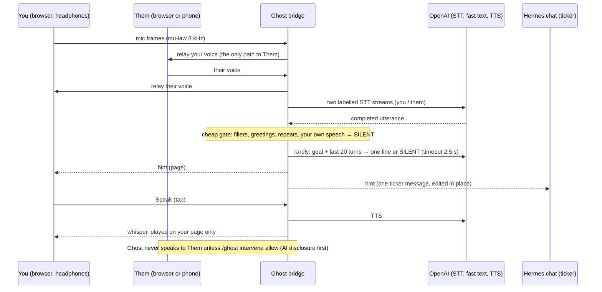

# hermes-ghost-call

**Ghost Call Copilot for [Hermes Agent](https://github.com/NousResearch/hermes-agent).**
You make (or take) a normal call. Hermes listens and whispers one-line hints to you only.

> *Hermes never joined the call. Earpiece only.*

```
01:05 · they said Saturday only → offer Friday 19:30 or Sunday
01:22 · $95 set menu is over budget → ask for à la carte
01:40 · they asked for a name → say Winch
```

A sibling of [hermes-phone](https://github.com/winchxyz/hermes-phone), not a fork: hermes-phone
is an AI that places the call; Ghost Call keeps *you* on the line and stays silent.

## 90-second demo (web mode, no Twilio needed)

1. In Hermes: `/ghost start book a table Friday 8pm for 4, budget $80, name Winch`
2. Hermes replies with two one-time links. Open **You** with headphones. A friend (or a second
   tab) opens **Them** and plays the restaurant.
3. Them: *"Friday is full, we only have Saturday."* A ticker line appears in the Hermes chat and
   on your page: `00:14 · they said Saturday only → offer Friday 19:30 or Sunday`. No question,
   no card, no approval.
4. Tap **Speak hint** (or `/ghost speak`): the hint plays in your earpiece. Your mic sends silence
   while it plays, so Them never hears it.
5. Hang up. Exactly one summary arrives: what was agreed, date, amount, open questions, and a
   draft follow-up SMS.

Talking track for a recording: [docs/DEMO.md](docs/DEMO.md).

## How it works



The plugin (inside Hermes) and the bridge (`hermes ghost serve`, a FastAPI process) share one
SQLite file. The plugin creates sessions and one-time links, pushes the ticker and posts the
summary; the bridge carries audio, runs transcription, the gate and the hint model.

**Latency.** A hint lands about 1-2 s after the other party finishes a meaningful sentence (the hint model alone measured 0.6-1.3 s):
server VAD closes an utterance after ~500 ms of silence, the gate is pure Python, and the hint
model (default `gpt-4.1-mini`, temperature 0.2, ≤ 60 tokens) has a hard 2.5 s timeout. A slow
hint is skipped, never queued. Partial transcripts only update the caption on your page.

**Three modes.** *Web* (default): two browser pages, audio relayed by the bridge. *Twilio*
(`/ghost start +15551234567 <goal>`): Twilio rings your phone, then the callee, into one
conference; each leg forks its inbound audio to the bridge with a receive-only
`<Start><Stream>`. Whispers are conference announcements to your leg only. If Twilio config is
incomplete, sessions fall back to web mode automatically. Setup: [docs/TWILIO.md](docs/TWILIO.md).
*Room* (`/ghost start room <goal>`): any call you already make (phone, WhatsApp, Telegram) on
speaker next to a laptop; one listening page hears both sides through its mic, nothing is
relayed, and Intervene is impossible. The bridge uses far-field noise reduction, a more sensitive
VAD and automatic gain there, because the phone speaker is quieter than you. Speakers are
unlabelled in this mode, so the hint model works out who said what from the content.

**Transcription vocabulary.** Each STT session gets the names and amounts from the goal as a
bare word list (never its sentences), which fixes "sixty" heard as "fifty" on a thin phone voice.
A transcript that is mostly that list (the model echoing its prompt on noise) is dropped.

## Ghost Call vs hermes-phone

| | hermes-phone | hermes-ghost-call |
|---|---|---|
| Who talks | The AI calls and speaks | You talk; Hermes is silent |
| Hermes on the line | A party to the call (disclosed) | Not a party; earpiece only |
| Mid-call UX | Question cards, `/phone answer`, hold lines | One-line hints, never questions |
| Approval | Three gates before dialing | `/ghost start` is the consent to listen; only Intervene needs `/ghost intervene allow` |
| After the call | Result message | One summary: agreed, date, amount, open items, draft SMS |

## UX law: silent by default

| Action | Approval? |
|---|---|
| Start listening (`/ghost start`) | No extra card: the command is the consent to listen |
| Stream hints to your chat and page | Never |
| Whisper a hint into your earpiece | Never (audio stays on your page / your leg) |
| Ask you a question mid-call | **Forbidden**: no code path can |
| Intervene: speak to the other party | One sticky `/ghost intervene allow` per session; always blocked in cron/unattended runs |
| Hangup, status, transcript, summary | No |

Hard limits: ≥ 4 s between hints, ≤ 40 hints per call, coalescing instead of stacking; fillers,
greetings, backchannels and repeats are SILENT; hints that read as questions to you are dropped.

## Install

Hermes discovers user plugins in `~/.hermes/plugins/<name>/`:

```bash
git clone https://github.com/winchxyz/hermes-ghost-call ~/.hermes/plugins/hermes-ghost-call
```

```yaml
# ~/.hermes/config.yaml
plugins:
  enabled:
    - hermes-ghost-call
```

Hermes does not auto-install plugin Python deps: `hermes plugins validate
~/.hermes/plugins/hermes-ghost-call --install-deps` does, or install
`fastapi uvicorn[standard] websockets httpx` into Hermes' venv yourself.

Then run the bridge where the plugin's `HERMES_HOME` is visible (same machine or container):

```bash
hermes ghost serve
```

Expose it (`cloudflared tunnel --url http://localhost:8766` or ngrok) and set `PUBLIC_BASE_URL` to
that URL; for a same-machine demo `http://localhost:8766` is enough. `/ghost check` (or
`hermes ghost doctor`) reports the setup, names only.

The [Dockerfile](Dockerfile) builds one container with the Hermes gateway, this plugin and the
bridge under s6 (the hermes-phone lesson: plugin and bridge must share the SQLite file).

### Local demo without Hermes

macOS / Linux (bash, zsh):

```bash
python -m venv .venv && .venv/bin/pip install -e . -r requirements-dev.txt
OPENAI_API_KEY=sk-... .venv/bin/python scripts/dev_demo.py 'book a table Friday 8pm for 4, budget $80, name Winch'
```

Windows (PowerShell):

```powershell
python -m venv .venv; .venv\Scripts\pip install -e . -r requirements-dev.txt
.venv\Scripts\python scripts\dev_demo.py 'book a table Friday 8pm for 4, budget $80, name Winch'
```

Ready-made scenarios: `scripts/dev_demo.py isp` (haggle with the internet provider for a
discount) and `scripts/dev_demo.py table`. Each prints a cheat sheet for whoever plays the other
party; the full scripts are in [docs/DEMO.md](docs/DEMO.md). Add `room` for speakerphone mode
(`dev_demo.py isp room`) or the other party's number for Twilio mode (`dev_demo.py isp
+972XXXXXXXXX https://your-public-address`, see [docs/TWILIO.md](docs/TWILIO.md)).

Single quotes keep the shell from expanding `$80`. The demo (only the demo, never the plugin) also
reads `OPENAI_API_KEY`, `PUBLIC_BASE_URL` and `GHOST_USER_NAME` from a git-ignored `demo.env` in
the repo root. With no key anywhere it asks for one with hidden input, so the key never lands on
screen or in shell history.

It starts the bridge on `http://localhost:8766`, prints the You/Them links and prints every chat
message the plugin would post (the ticker and the summary). Type `speak`, `allow`, `say <text>`,
`hangup` at the prompt, or rehearse without a mic: `them <line>` / `you <line>`.

### Voice test with two bot callers (no humans, no mic)

```bash
python scripts/e2e_call.py
```

It voices both sides of the ISP call with OpenAI TTS (two voices), joins the You and Them links
like the pages do, streams real-time 20 ms audio frames through the bridge and its realtime STT,
taps **Speak hint**, transcribes the earpiece whisper and everything the Them side heard, hangs
up and checks: speech transcribed, hints arrived, the whisper says the hint, the Them socket got
nothing but audio, no hint text in what Them heard, exactly one summary. A run takes ~2 minutes
and a few cents. Last run (2026-11-07): all six checks passed, hints 1.4-1.8 s after the other
party's line, whisper 1.4-2.0 s after the tap.

`python scripts/e2e_call.py --room` runs the same call in speakerphone mode: both voices go into
one microphone, the far side band-limited to 300-3400 Hz and quieter, like a phone on speaker.
Without the far-field settings the transcriber heard 0 of the 6 phone lines; with them, all 6,
and the summary reads "$60/month for 12 months, no contract".

## Tools, commands, hooks

| Tool | What it does |
|---|---|
| `ghost_start` | Create a session (goal, callee label, mode). Returns join links (web) or rings your phone (Twilio). |
| `ghost_status` | State, duration, hint count, Intervene flag |
| `ghost_hint_latest` | Last N hints, for after-the-fact questions (never polled live) |
| `ghost_speak` | Whisper a hint into your earpiece only |
| `ghost_intervene` | Speak on the far leg; refused without the sticky allow; AI disclosure first |
| `ghost_hangup` | End within ~1 s, even if the bridge is gone |
| `ghost_summary` | The post-call summary (also auto-posted once) |

`/ghost start [room|+number] <goal>` · `status [id]` · `speak [hint]` · `intervene allow|deny [id]` ·
`hangup [id]` · `transcript [id]` · `log [n]` · `check`

Hook: `pre_tool_call` blocks `ghost_intervene` without the allow and under cron/unattended
surfaces (fails closed). There is no `pre_llm_call` hook and no question-card pipeline.
Skill: `ghost-call` (start, relay links, then stay quiet).

## Configuration

| Setting | Default | Notes |
|---|---|---|
| `hint_mode` | `auto` | `tap`: hints only when you tap **Hint** |
| `min_hint_interval_s` | `4` | floor 4 |
| `max_hints_per_session` | `40` | ceiling 40 |
| `model` | `gpt-4.1-mini` | fast text model for hints and the summary |
| `stt_model` | `gpt-4o-mini-transcribe` | realtime transcription (`gpt-live-*` uses a client VAD) |
| `voice` | `coral` | earpiece TTS voice (`gpt-4o-mini-tts`) |
| `max_duration_s` | `900` | hard session cap (60 to 3600) |
| `daily_session_limit` | `20` | rolling 24 h |
| `store_transcripts` | `true` | text only; never audio |
| `user_name` | | used in the Intervene disclosure and the SMS draft |
| `user_number` | | Twilio mode: your phone, E.164 |

### Environment (names only)

| Name | Needed for |
|---|---|
| `OPENAI_API_KEY` | transcription, hints, whisper TTS, summary (secret) |
| `PUBLIC_BASE_URL` | the join links and Twilio webhooks |
| `TWILIO_ACCOUNT_SID`, `TWILIO_AUTH_TOKEN`, `TWILIO_FROM_NUMBER` | Twilio mode only (secrets) |
| `HERMES_GHOST_TEST_ALLOWLIST` | developer allowlist of E.164 numbers Twilio may dial; empty = none |
| `HERMES_GHOST_ALLOW_ALL=1` | developer opt-out of the allowlist (never set by the model) |
| `HERMES_GHOST_TRUST_PROXY=1` | rate-limit on `X-Forwarded-For` behind a proxy |
| `HERMES_GHOST_DB` | shared SQLite path (default: Hermes plugin data dir) |
| `HERMES_GHOST_BRIDGE_HOST` / `_PORT` | bridge bind (default `127.0.0.1:8766`, or `PORT`) |

## Safety

- **Secrets** only through `agent.secret_scope.get_secret` (profile-scoped); outside Hermes the
  bridge reads its own process env. A scope error fails closed. No `.env` reading, keys never in
  logs, tool output or errors (tests plant marker keys and check).
- **No audio on disk.** Audio lives in memory only; transcripts are text and can be turned off.
- **Intervene** is off by default, needs `/ghost intervene allow` typed by you (no tool can set
  it), is re-checked by the hook, the tool and the bridge, is always blocked under cron or
  unattended surfaces, and its first words are *"This is an AI assistant speaking on behalf of
  …"*.
- **Dialing** (Twilio mode only): strict E.164, emergency/short-code/premium blocklist (911, 112,
  999, 000, 110, 119, 100-103, +1 900, +1 976 …) that even `ALLOW_ALL` cannot lift, and a
  fail-closed developer allowlist checked in the plugin and again in the bridge. Web mode dials
  nothing. No auto-redial.
- **Limits:** one active session, 20 sessions a day, 900 s cap, `/ghost hangup` within ~1 s.
- **Web routes:** one-time hashed link and media tokens, strict CSP with nonces, generic 404s,
  per-client rate limit on a stable host key.

## Capability disclosure (for catalog review)

- **Network:** OpenAI (Realtime transcription websocket, chat completions, TTS) from the bridge
  and, for a fallback summary, the plugin. Twilio REST and webhooks only in Twilio mode. No
  other hosts, no telemetry.
- **Local server:** FastAPI bridge (`hermes ghost serve`) serving the two call pages, their
  websockets, `/healthz` and Twilio webhooks.
- **Storage:** SQLite in Hermes' plugin data dir: sessions, hashed tokens, text transcripts
  (optional), hints, summaries. No audio files.
- **Secrets:** `OPENAI_API_KEY`, Twilio credentials via `secret_scope`; never printed.
- **Hooks:** `pre_tool_call` (blocks `ghost_intervene` only). No `pre_llm_call`.
- **Microphone:** the browser pages ask for the mic only after a tap.

## Legal notes (not legal advice)

- Ghost Call is assistive listening: Hermes is not a party to the call and does not speak on
  it, so nothing is announced on the line. Some jurisdictions still require **all parties'
  consent** to record or transcribe a call (two-party consent). Know your local rules and tell
  the other party when required.
- Only text is stored (transcripts and hints), never audio files. `store_transcripts: false`
  keeps the transcript in memory for the summary only.
- If you allow Intervene, Hermes *does* speak on the call; its first words disclose that it is an
  AI assistant acting for you.
- Not investment, legal or medical advice.

## Testing and honest limits

```bash
pip install -e . -r requirements-dev.txt
ruff check . && pytest -q -m "not e2e"
```

220 unit tests, no network: the gate, rate limits and coalescing, the no-question invariant,
Intervene blocked without allow and under cron, allowlist fail-closed, write-once summary,
planted secret markers, websocket relay and who-hears-what, room mode. OpenAI and Twilio are
mocked. The web flow was also driven end to end in headless Chromium with a fake microphone
(relay both ways, whisper reached only the You page, one ticker message, one summary).

Live, with real OpenAI: `scripts/e2e_call.py` (web and `--room`) passes all its checks with two
synthetic voices. Not yet run live: Twilio mode (mocks only), room mode with a real phone on a
real speaker, and the plugin inside a running Hermes chat (CI runs `hermes plugins validate` and
`hermes plugins doctor --ci` against a pinned hermes-agent commit, which loads it but places no
call).

`video/` holds the launch video pipeline. The call lines are voiced in ElevenLabs (two male
voices, saved as `video/voices/lineNN.pcm`), then `scripts/e2e_call.py --clips video/voices
--timeline video/timeline.json` runs the real test on those takes, so every caption, hint and
summary on screen comes from it. `python video/build.py` lays narration, call and whisper end to
end, `node video/render.mjs` renders the frames (playwright-core and ffmpeg) and
`python video/voice_mix.py` adds the narrator. Script and timecodes: `video/SCRIPT.md`,
`video/TIMECODES.txt`.

Not in v0.1: screen OCR context (planned behind `HERMES_GHOST_SCREEN=1`), voice cloning (never),
auto-playing every hint, a catalog entry. To list it later, open a PR to
`NousResearch/hermes-agent` adding `plugin-catalog/hermes-ghost-call.yaml` pinned to a 40-hex SHA.

Layout note: the package sits at the repo root (`hermes_ghost_call/`) next to the root
`__init__.py`, because Hermes loads a plugin by importing `<plugin dir>/__init__.py`; a `src/`
layout would not load.

## License

MIT, see [LICENSE](LICENSE).
